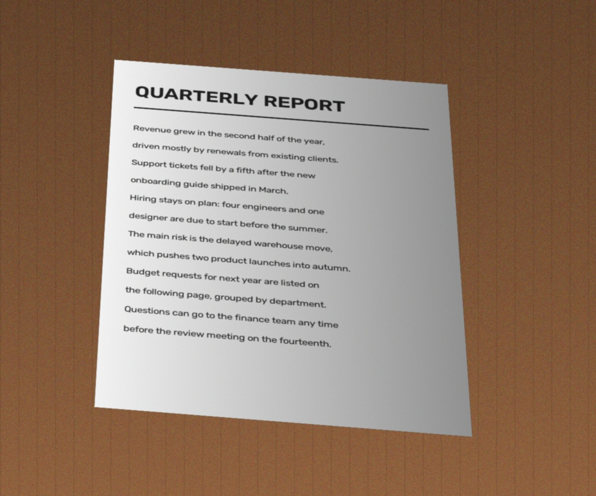
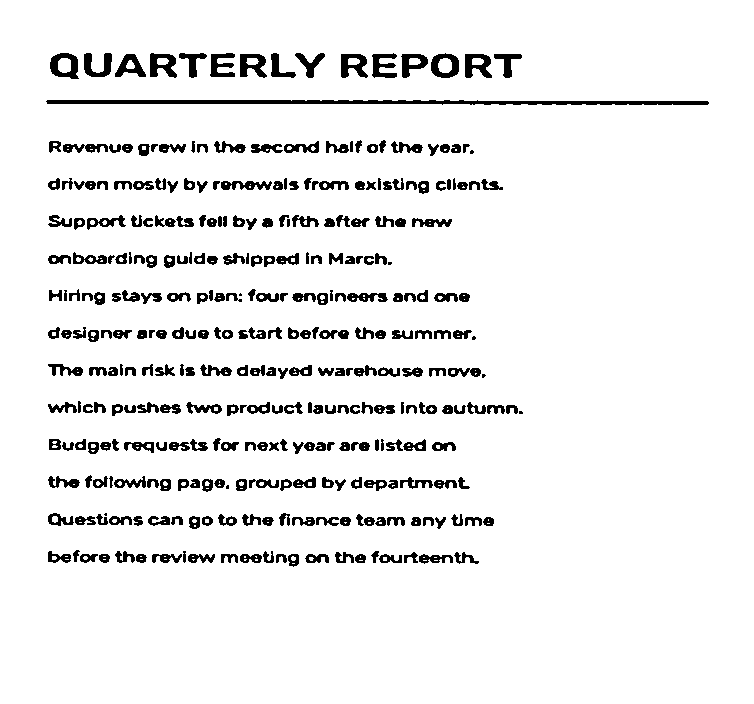

# docscan

Turn a photo of a document into a flat, evenly lit scan. Classical computer
vision only: no trained models, no GPU, one small dependency (OpenCV).

| Photo | Detected corners | Result (`--mode bw`) |
| --- | --- | --- |
|  |  |  |

The images above are synthetic (a rendered page, warped onto a noisy table
texture with a shadow gradient) so that the repository can ship with ground
truth and the tests can check corner accuracy. See [Limitations](#limitations)
for how it behaves on real photos.

## How it works

1. **Find the page.** The photo is downscaled to 500 px tall. Three masks are
   tried in order: Canny edges, an Otsu threshold, and its inverse. For each
   mask the largest contours are reduced to their convex hull and simplified
   with `approxPolyDP`; the first one with exactly four vertices that covers at
   least 20% of the frame wins. Corners are scaled back to the original
   resolution.
2. **Order the corners.** Points are sorted by angle around their centroid and
   rotated so the top-left comes first. This works for pages rotated well past
   the 45 degrees where the usual sum/difference trick breaks.
3. **Flatten the perspective.** A homography maps the quadrilateral to an
   upright rectangle sized from its longest opposite edges. A thin border
   (`--trim`, 1% by default) is cropped because the detected corners are never
   pixel-exact and the edge picks up background.
4. **Fix the lighting** (`gray` and `bw` modes). A dilation plus median blur
   estimates the paper brightness, and the image is divided by it, which
   removes shadows and gradients. `bw` then applies a Gaussian adaptive
   threshold.

## Install

```bash
git clone https://github.com/<your-username>/docscan.git
cd docscan
pip install -e ".[dev]"
```

Python 3.9 or newer.

## Usage

```bash
docscan photo.jpg                       # colour scan into ./scans/photo_scan.png
docscan photo.jpg -m bw --outline       # black and white, plus a debug image
docscan *.jpg -m gray -o out/           # several photos at once
python -m docscan photo.jpg             # same thing without the entry point
```

| Option | Meaning |
| --- | --- |
| `-m, --mode` | `color` (default), `gray`, or `bw` |
| `-o, --out-dir` | output directory, created if needed (default `scans`) |
| `--trim` | fraction of each side to crop after warping, 0 to 0.25 (default 0.01) |
| `--outline` | also write `<name>_outline.jpg` with the detected corners drawn |

The exit code is 1 if any input could not be read or no document was found;
the remaining files are still processed.

From Python:

```python
import cv2
from docscan import scan, DocumentNotFound

photo = cv2.imread("photo.jpg")
try:
    result = scan(photo, mode="gray")
except DocumentNotFound:
    ...
cv2.imwrite("scan.png", result.image)
print(result.corners)  # 4x2 array in photo coordinates, TL TR BR BL
```

## Tests

```bash
pytest
ruff check .
```

The tests build photos with known corner positions (`tests/synthetic.py`) and
check that detection lands within 12 px of the truth across several layouts,
that `bw` output is strictly binary with clean margins despite a 40% shadow
gradient, and that the CLI handles bad input without stopping a batch.
To regenerate the README images: `python -m tests.synthetic`.

## Limitations

- **One page, four straight edges.** Curled, folded or partly covered pages
  will not produce a clean quadrilateral. A circle can also be mistaken for a
  square.
- **Needs contrast with the background.** White paper on a white desk has no
  edge to find.
- **Aspect ratio is estimated** from edge lengths, not from camera intrinsics,
  so strong perspective gives a slightly wrong width-to-height ratio.
- **Tested on synthetic scenes plus the logic above, not on a real photo
  dataset.** Before relying on it, try it on your own photos and open an issue
  with failures. A natural next step is a small evaluation script over a
  public dataset such as SmartDoc.

## Layout

```
src/docscan/
    detect.py      page detection
    geometry.py    corner ordering and perspective warp
    enhance.py     lighting correction and thresholding
    pipeline.py    scan() and outline drawing
    cli.py         command line interface
tests/             pytest suite and synthetic photo generator
```

## License

MIT
